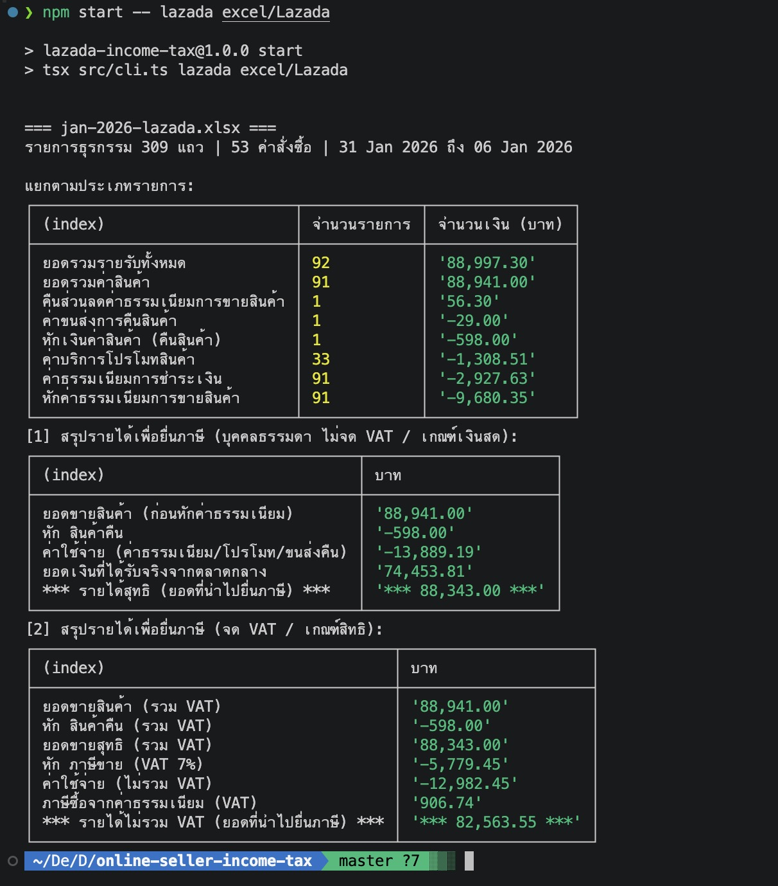
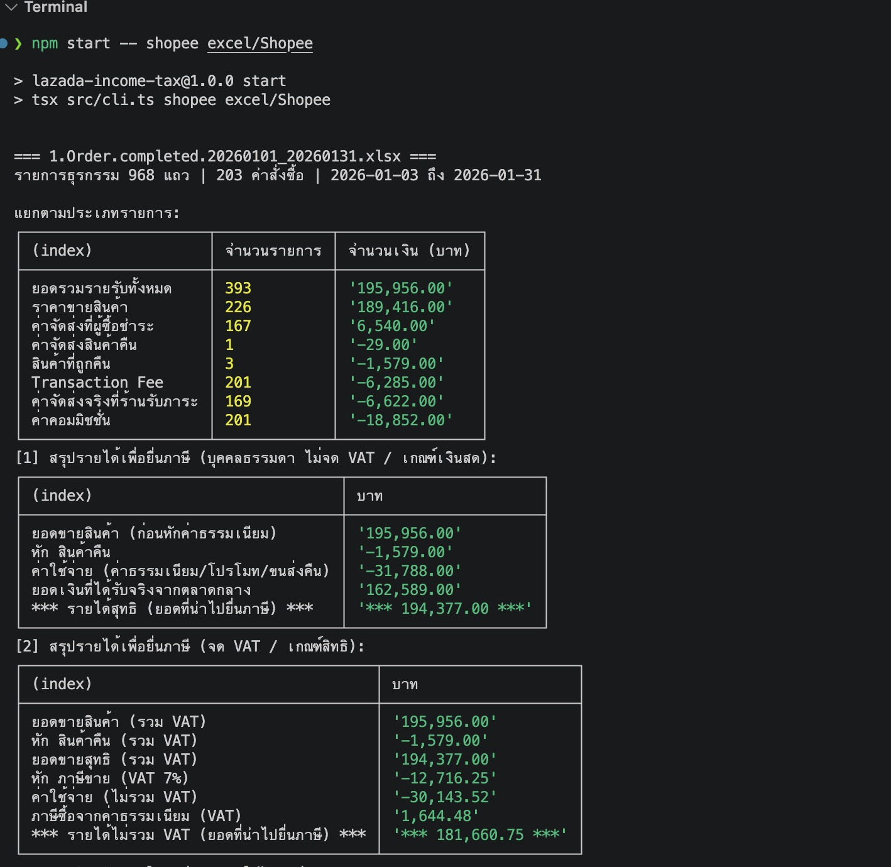

# Online Seller Income Tax

โปรแกรม Node.js + TypeScript สำหรับสรุป **ยอดรายได้เพื่อยื่นภาษี** ของผู้ขายออนไลน์ โดยอ่านจากไฟล์ Excel ที่ดาวน์โหลดจาก **Lazada** และ **Shopee** แล้วพิมพ์ตารางสรุปออกทาง console

แสดงผล 2 แบบแยกกัน:

1. **[1] บุคคลธรรมดา ไม่จด VAT / เกณฑ์เงินสด**
2. **[2] จด VAT / เกณฑ์สิทธิ์** (ถอด VAT 7% ออกแล้ว)

> ⚠️ โปรแกรมนี้ช่วยคำนวณเพื่อประกอบการตัดสินใจเท่านั้น ไม่ใช่คำแนะนำด้านภาษี ก่อนยื่นจริงควรให้นักบัญชีหรือสรรพากรยืนยันตัวเลขอีกครั้ง (ดูหัวข้อ [ข้อสมมติและข้อควรระวัง](#ข้อสมมติและข้อควรระวัง))

## ตัวอย่างผลลัพธ์

### Lazada



### Shopee



แถวที่ขึ้นต้นและลงท้ายด้วย `***` คือ **ยอดที่นำไปยื่นภาษี** ของแต่ละแบบ

## การติดตั้ง

ต้องมี [Node.js](https://nodejs.org) (ทดสอบกับ v22)

```bash
npm install
```

## วิธีใช้งาน

### 1. ดาวน์โหลดไฟล์จากร้านค้า

| ตลาดกลาง | รายงานที่ใช้ | ที่มาของไฟล์ |
|---|---|---|
| **Lazada** | Income Overview (รายละเอียดรายรับ) | Seller Center → การเงิน → รายละเอียดรายรับ → ดาวน์โหลด |
| **Shopee** | `Order.completed` (คำสั่งซื้อที่สำเร็จ) | Seller Centre → คำสั่งซื้อของฉัน → ส่งออก |

ชื่อเมนูอาจเปลี่ยนตามเวอร์ชันของ Seller Center เลือกช่วงวันที่ให้ตรงกับเดือนหรือปีภาษีที่ต้องการ

### 2. วางไฟล์ในโฟลเดอร์

```
excel/
  Lazada/   ← ไฟล์ .xlsx ของ Lazada
  Shopee/   ← ไฟล์ .xlsx ของ Shopee
```

วางได้หลายไฟล์ (เช่นไฟล์รายเดือน) โปรแกรมจะสรุปแยกตามไฟล์ และรวมยอดให้เมื่อมีมากกว่าหนึ่งไฟล์

> ไฟล์ `*.xlsx` ถูกใส่ไว้ใน `.gitignore` เพราะมีข้อมูลลูกค้าและยอดขายจริง จะไม่ถูกอัปโหลดขึ้น git

### 3. รันโปรแกรม

```bash
npm start                                  # Lazada (อ่านจาก excel/Lazada)
npm start -- lazada                        # เหมือนข้างบน
npm start -- shopee                        # Shopee (อ่านจาก excel/Shopee)
npm start -- lazada excel/Lazada           # ระบุโฟลเดอร์เอง
npm start -- shopee path/to/other-folder
```

รูปแบบคำสั่ง: `npm start -- [marketplace] [โฟลเดอร์]`

### 4. อ่านผลลัพธ์

โปรแกรมพิมพ์ 3 ส่วนต่อไฟล์:

1. **แยกตามประเภทรายการ** จำนวนรายการและยอดเงินของแต่ละประเภทธุรกรรม (แถวบนสุดคือ "ยอดรวมรายรับทั้งหมด" ซึ่งตรงกับตัวเลขในหน้า Lazada Seller Center)
2. **[1] ไม่จด VAT / เกณฑ์เงินสด** ยอดขายสินค้า หักสินค้าคืน ค่าใช้จ่าย และรายได้สุทธิ
3. **[2] จด VAT / เกณฑ์สิทธิ์** ยอดขายรวม VAT หักภาษีขาย (7/107) ค่าใช้จ่ายและภาษีซื้อ และรายได้ก่อน VAT

## วิธีคำนวณ

### Lazada

| รายการ | วิธีนับ |
|---|---|
| ยอดขาย | ผลรวม `ยอดรวมค่าสินค้า` |
| สินค้าคืน | `หักเงินค่าสินค้า (คืนสินค้า)` หักออกจากรายได้ |
| ค่าใช้จ่าย | ค่าธรรมเนียมการขาย ค่าธรรมเนียมการชำระเงิน ค่าโปรโมท ค่าขนส่งคืน (หักสุทธิจาก "คืนส่วนลดค่าธรรมเนียม") |
| **รายได้เพื่อยื่นภาษี [1]** | ยอดขาย − สินค้าคืน (ไม่หักค่าธรรมเนียม) |
| **รายได้เพื่อยื่นภาษี [2]** | (ยอดขาย − สินค้าคืน) × 100/107 |

### Shopee

คำนวณต่อ **คำสั่งซื้อ** เฉพาะสถานะ "สำเร็จแล้ว" ตามวิธีในคลิป [ภาษีกลางปี ภ.ง.ด.94 ขาย Lazada-Shopee](https://www.youtube.com/watch?v=BC1HNdvJhX8) ของช่อง ภาษีต้องรู้ ของผู้ขายออนไลน์

```
รายได้ = ราคาขายสุทธิ
        − ส่วนลดโค้ดผู้ขาย
        − ส่วนลด bundle deal ผู้ขาย
        + ค่าจัดส่งที่ผู้ซื้อชำระ
        − สินค้าที่ถูกคืน
```

- ส่วนลดที่ Shopee ออกให้ (โค้ด Shopee, เหรียญ, โปรโมชั่นช่องทางชำระเงิน) **ไม่หัก** เพราะ Shopee เป็นผู้จ่าย
- ค่าธรรมเนียม ค่าส่งจริง และภาษีซื้อ แสดงไว้ประกอบ ไม่ได้นำมาหักจากยอดที่ใช้ยื่น
- ไฟล์ Shopee มีค่าคอมมิชชั่น ค่า Transaction Fee และค่าส่งซ้ำทุกแถวสินค้าของออเดอร์เดียวกัน โปรแกรมนับครั้งเดียวต่อออเดอร์

## ข้อสมมติและข้อควรระวัง

- **ราคาขายรวม VAT แล้ว:** ในแบบ [2] โปรแกรมสมมติว่าราคาขายรวม VAT 7% แล้วและถอดออกด้วย ×7/107 ถ้าราคาขายของคุณยังไม่รวม VAT ให้ใช้ยอดก่อนหัก VAT แทน
- **ค่าธรรมเนียม Shopee:** ไฟล์ไม่มีคอลัมน์ VAT จึงสมมติว่าค่าธรรมเนียมรวม VAT แล้ว ภาษีซื้อเป็นค่าประมาณ ควรเทียบกับใบกำกับภาษีจริง
- **สินค้าคืน:** โปรแกรมหักสินค้าคืนจากรายได้ เพราะผู้ซื้อได้เงินคืนแล้ว สำหรับร้านที่จด VAT การลดยอดขายต้องมีใบลดหนี้ที่ถูกต้องรองรับ
  - Shopee: ตรวจจากคอลัมน์ `จำนวนที่ส่งคืน` (และดู `สถานะการคืนเงินหรือคืนสินค้า` ประกอบ)
  - Lazada: ตรวจจากคอลัมน์ `ชื่อรายการธุรกรรม` ที่เป็น "หักเงินค่าสินค้า (คืนสินค้า)"
- **ออเดอร์ที่ยกเลิก:** รายงาน `Order.completed` ของ Shopee มีเฉพาะออเดอร์ที่สำเร็จ ออเดอร์ที่ไม่สำเร็จจะถูกข้ามอยู่แล้ว
- **เกณฑ์เงินสดของ Shopee:** คลิปใช้รายงาน Income (ค่า A + B) ซึ่งเป็นคนละไฟล์กับ `Order.completed` ผลที่โปรแกรมคำนวณจากไฟล์ Order อาจต่างจากรายงาน Income เล็กน้อย
- **ไฟล์ Lazada:** ไฟล์ที่ดาวน์โหลดระบุขนาดตารางผิด (`A1:A310`) ทำให้ไลบรารี xlsx เห็นแค่คอลัมน์เดียว โค้ดจึงบังคับอ่านช่วงใหม่ให้อัตโนมัติ

## โครงสร้างโปรเจกต์

```
src/
  core/                       ไม่ผูกกับตลาดกลางใด ใช้ซ้ำได้
    types.ts                  Transaction, MarketplaceParser, TaxSummary
    tax-calculator.ts         class TaxCalculator (เกณฑ์เงินสด / เกณฑ์สิทธิ์)
    console-reporter.ts       class ConsoleReporter (พิมพ์ตาราง)
  marketplaces/
    lazada/lazada-parser.ts   class LazadaParser
    shopee/shopee-parser.ts   class ShopeeParser
  index.ts                    export สำหรับใช้เป็น library
  cli.ts                      คำสั่ง npm start
excel/                        ไฟล์ Excel ของร้าน (ไม่ถูก commit)
Screenshot/                   ภาพตัวอย่างผลลัพธ์
```

### ใช้เป็น library

```ts
import { LazadaParser, TaxCalculator } from "./src/index.js";

const transactions = new LazadaParser().parse("excel/Lazada/jan-2026-lazada.xlsx");
const summary = new TaxCalculator().calculate(transactions);

console.log(summary.cashBasis.income);       // ยอดยื่น เกณฑ์เงินสด
console.log(summary.accrualBasis.incomeExVat); // ยอดยื่น เกณฑ์สิทธิ์ (ก่อน VAT)
```

### เพิ่มตลาดกลางใหม่ (เช่น TikTok Shop)

1. สร้าง parser ที่ `implements MarketplaceParser` (`name`, `extensions`, `parse(file)`) ให้คืนค่าเป็น `Transaction[]` โดยระบุ `category` ของแต่ละแถวเป็น `sale` / `sale_return` / `expense` / `other`
2. เพิ่ม parser ในรายการ `parsers` ที่ `src/cli.ts`

`TaxCalculator` และ `ConsoleReporter` ไม่ต้องแก้

## คำสั่งอื่นๆ

```bash
npm run build        # คอมไพล์ TypeScript ไปที่ dist/
npx tsc --noEmit     # ตรวจ type เท่านั้น
```
